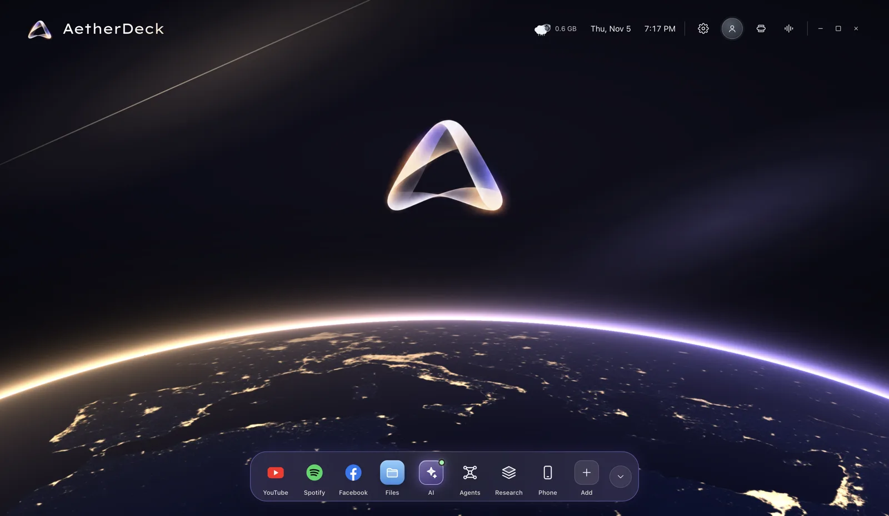
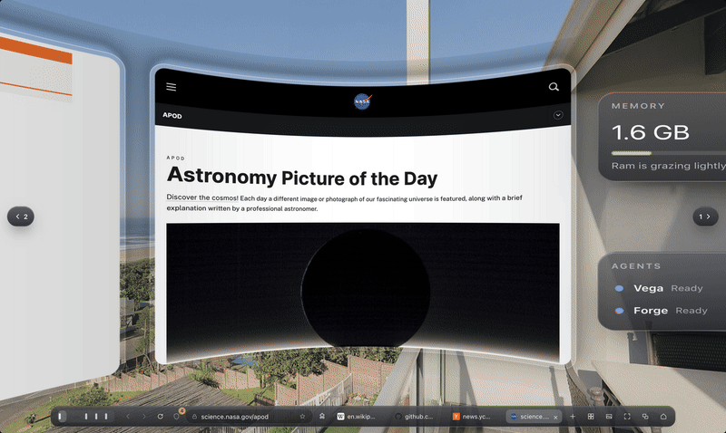
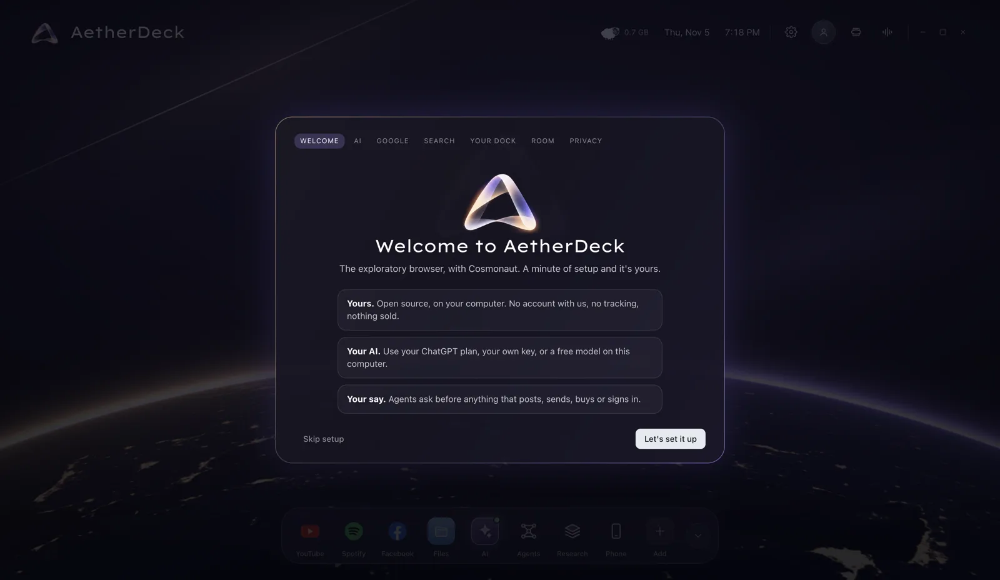

<div align="center">


# AetherDeck

**The exploratory browser, with Cosmonaut.**

Ask anything and get **the answer first**, with every source mapped around it.<br>
Bring **your own AI**: your ChatGPT plan, a free key, or a model on your own computer.<br>
Give a **crew of agents** any task. They research, build websites and post for you, and they ask before anything that matters.

[](https://github.com/tajwarah/aetherdeck/releases)
[](https://github.com/tajwarah/aetherdeck/releases)
[](https://github.com/tajwarah/aetherdeck/stargazers)
[](LICENSE)

[](CONTRIBUTING.md)

[**Download**](#-download) · [Features](#-what-it-does) · [Quick start](#-quick-start) · [Agents](#-agents) · [Guide](docs/GUIDE.md) · [Roadmap](#-roadmap) · [Contribute](CONTRIBUTING.md)



</div>

## ✨ Why AetherDeck

A search engine hands you ten links. A chatbot hands you an answer you can't check. **AetherDeck does both, in one place.** It reads the sites your search engine finds, writes the answer in a few sentences, and numbers every sentence to the sites it came from. Those sites sit around the answer on a map you can zoom, drag and open.

It's also a complete everyday browser (Chromium inside, so every site works), with a crew of AI agents built in. And it's yours:

- **No account, no server, no tracking.** It runs on your computer. Your history is off by default and never leaves it.
- **Your AI, your bill.** Sign in with your ChatGPT plan, paste a key (Gemini, Groq and OpenRouter have free tiers), or run a model on your own machine for free.
- **Agents that ask first.** Anything that posts, sends, buys, deletes or signs in waits for your OK. Agents never type passwords or solve a CAPTCHA.
- **Open source, Apache-2.0.** Fork it, build on it, ship it. [Just credit the original](#-build-on-aetherdeck).

## 🌍 What it does

<table>
<tr>
<td width="50%"></td>
<td width="50%"></td>
</tr>
<tr>
<td><b>Answers first, every source mapped.</b> Ask a question and the answer is written first, in the middle. Each sentence is numbered to the sites it rests on, and the sites carry the same numbers. Point at a sentence and its sources light up.</td>
<td><b>A crew of agents, at mission control.</b> Type any task once. A crewmate takes it, or a new agent is drafted for it. Watch every agent live, approve what needs you, and schedule the ones that repeat.</td>
</tr>
</table>

### 🥽 Your tabs, all around you

<div align="center">

</div>

Press the **360°** button (or Cmd/Ctrl + Shift + U) and every tab hangs around you on curved glass, like a headset without the headset. Turn with a swipe, a drag or Alt + ←/→. Click, scroll and type in any page as usual. Watch a video full screen on its panel. Pick a seaside balcony, a home office, a glass house or a loft, or use your own 360° photo of your room. Clocks, notes and your agents hang on the wall beside your tabs, wherever you drag them.

| | |
|---|---|
| 🔎 **Research** | Reads Google, Bing or DuckDuckGo results the way you'd see them, plus open sources (Wikipedia, arXiv, OpenAlex, news, OpenStreetMap). Reads the top pages in full, then writes a cited answer. Without a model, it quotes the sources' best sentences, word for word. |
| 🧭 **A map, not a list** | Sub-questions, findings and every site on one zoomable canvas. Drag cards together to group them, open a group as tabs, and keep searches on a research board. |
| 🤖 **Agents** | They research, think, ask each other for help, make artifacts (reports, pages, charts, code), build multi-file websites with a local link, post where you're signed in, and work in Canva, Notion, Google Docs and other web apps. |
| 🪐 **Cosmonaut** | Your AI companion. Ask about the page in front of you, or drop in a PDF, document, spreadsheet or image. |
| 🌐 **A real browser** | Tabs, groups, bookmarks, history, downloads, private windows, find, zoom, print, Chrome extensions, full-screen video. It can be your default browser. |
| 🔐 **Private by design** | Keys are encrypted by your system keychain. Sync is end-to-end encrypted. No telemetry. [How your data moves](SECURITY.md). |

## 📦 Download

Get the installer from the [**Releases**](https://github.com/tajwarah/aetherdeck/releases/latest) page:

| System | File | First launch |
|---|---|---|
| macOS (Apple silicon and Intel) | `AetherDeck-x.y.z-mac-arm64.dmg` or `…-mac-x64.dmg` | Not signed yet: open it once, then **System Settings → Privacy & Security → Open Anyway**. |
| Windows 10 and 11 | `AetherDeck-x.y.z-win-x64.exe` or `…-win-arm64.exe` | SmartScreen may warn about an unknown publisher: **More info → Run anyway**. |
| Linux | `AetherDeck-x.y.z-linux-x86_64.AppImage` or `…-linux-amd64.deb` | AppImage: `chmod +x` and run. Debian/Ubuntu: `sudo apt install ./AetherDeck-*.deb`. |

Windows and Linux update themselves. On macOS, AetherDeck tells you when a new version is out.

## 🚀 Quick start

1. **Install and open AetherDeck.** A one-minute setup walks you through it, and every step can be skipped:

   

   - **AI:** sign in with ChatGPT, paste a key, or pick a free local model.
   - **Google:** sign in on Google's own page, so YouTube, Gmail and Docs work.
   - **Search engine, dock, 360° room and privacy:** pick what suits you.
2. **Ask something.** Click anywhere on the home (or press `/`) and type a question, an address, or "play …".
3. **Give the crew a task.** Open **Agents** in the dock, type a task, and press **Deploy**.

Everything from the setup lives in **Settings**: the ⚙️ in the top bar, or Cmd/Ctrl + ,.

## 🤖 Agents

Give the Agent Station any task in one line. The board shows every agent live: what it's doing, how far along it is, what it needs from you, and when it runs next.

| Power | What it does |
|---|---|
| Always | Research with cited answers, think, ask a crewmate, read and arrange pages, keep notes, make artifacts, remember between runs |
| Harvest | Pull lists and tables from pages, crawl up to 40 pages politely, save CSV and JSON |
| Mail | Read your signed-in Gmail and open drafts for you to check. Agents can't send |
| Video | Read a YouTube video's details and transcript |
| Build | Make apps that run in a window, and multi-file websites in a folder you approve, served at a link only your computer can see |
| Post | Post to Facebook, Instagram, YouTube, X, LinkedIn and others where you're signed in, with files you choose. You approve every post |

Agents can run every hour, day or week while AetherDeck is open. Each one runs on the model you choose:

| Model | Cost | Setup |
|---|---|---|
| Your **ChatGPT** Plus or Pro plan | Counts toward your plan, up to the share you allow AetherDeck | **Sign in with ChatGPT** in Settings. You sign in on chatgpt.com, and AetherDeck never sees your password |
| [Ollama](https://ollama.com/download) or LM Studio on your computer | Free. Nothing leaves your computer | `ollama pull qwen3` (the model must support tools) |
| Ollama Cloud | Free plan includes `gemma4:31b-cloud` | Sign in to Ollama, or add a key in Settings |
| Groq, Gemini, OpenRouter | Free tiers with daily limits | Add a key in Settings |
| OpenAI, Anthropic Claude | Paid per use | Add a key in Settings |

On a billed provider, a run stops at 500,000 tokens. More in the [guide](docs/GUIDE.md).

## 🛠 Build from source

```bash
git clone https://github.com/tajwarah/aetherdeck.git && cd aetherdeck
npm install
npm run desktop:dev   # the desktop app with live reload
npm test              # 196 unit tests
npm run dist:mac      # or dist:win / dist:linux: installers in release/
```

Needs Node 22+. Architecture, data sources, environment variables and tests: [docs/GUIDE.md](docs/GUIDE.md). Design system: [docs/DESIGN.md](docs/DESIGN.md).

## 🗺 Roadmap

- [x] Answer-first research with numbered, checked citations
- [x] Agent Station: deploy bar, live board, schedules, crewmate hand-offs
- [x] Artifacts, local websites, posting with approval
- [x] Sign in with ChatGPT
- [x] First-run setup
- [ ] Signed and notarized macOS and Windows builds
- [ ] Publish agent-built websites to a public host (GitHub Pages, Netlify, Vercel), with your approval
- [ ] A shared library of agent recipes the community can install
- [ ] Phone ↔ laptop sync through a hosted relay
- [ ] Widevine, so Netflix and Spotify play

Have an idea? [Open a discussion](https://github.com/tajwarah/aetherdeck/discussions) or [request a feature](https://github.com/tajwarah/aetherdeck/issues/new/choose).

## 🤝 Contributing

Contributions are welcome, from typo fixes to new agent powers. Start with [CONTRIBUTING.md](CONTRIBUTING.md) and the [good first issues](https://github.com/tajwarah/aetherdeck/labels/good%20first%20issue). Please follow the [Code of Conduct](CODE_OF_CONDUCT.md), and report security issues privately as described in [SECURITY.md](SECURITY.md).

## 🧩 Build on AetherDeck

AetherDeck is **Apache-2.0**: use it, change it and ship it, commercially too. The one ask is credit. Keep the [NOTICE](NOTICE) file with your copy, and say somewhere people will see it (your README or About screen):

> Built on [AetherDeck](https://github.com/tajwarah/aetherdeck) by Tajwar Ahmed Fahim

Please give your project its own name and logo. The AetherDeck name, mark and Cosmonaut identify the original. To cite it in research, use [CITATION.cff](CITATION.cff) (GitHub's "Cite this repository" button).

## 🙏 Acknowledgments

- Earth at night: [NASA Earth Observatory, Black Marble](https://earthobservatory.nasa.gov/features/NightLights) (public domain)
- 360° rooms: [Poly Haven](https://polyhaven.com) (CC0)
- Lexend Exa typeface: [The Lexend Project](https://www.lexend.com) (SIL OFL 1.1)
- Built with [Electron](https://www.electronjs.org), [React](https://react.dev) and [Vite](https://vite.dev)
- Open data: Wikipedia, OpenAlex, arXiv, Hacker News, Stack Overflow, OpenStreetMap (© OpenStreetMap contributors), GDELT

## ⭐ Star history

<a href="https://star-history.com/#tajwarah/aetherdeck&Date"></a>

## 📄 License

[Apache License 2.0](LICENSE). Copyright 2026 Tajwar Ahmed Fahim. See [NOTICE](NOTICE) for attribution.

<div align="center"><sub>Made with care by <a href="https://github.com/tajwarah">Tajwar Ahmed Fahim</a>. If AetherDeck helps you, a ⭐ helps others find it.</sub></div>
