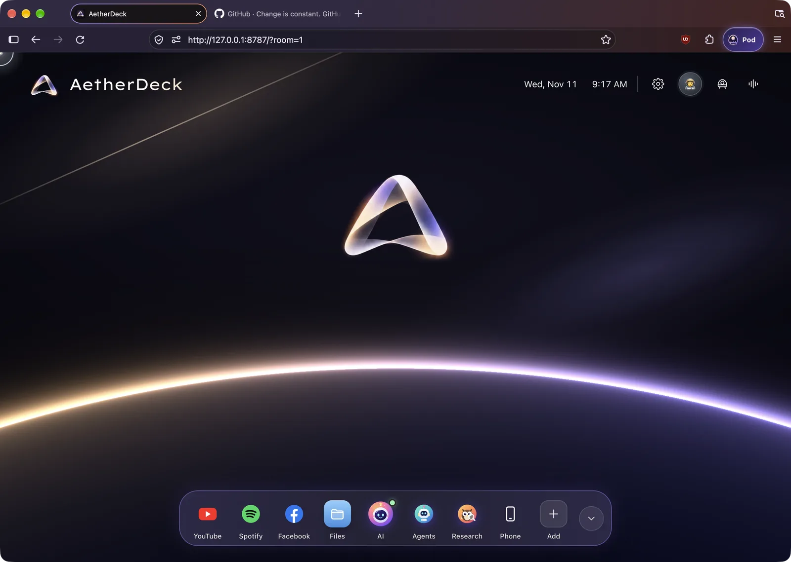
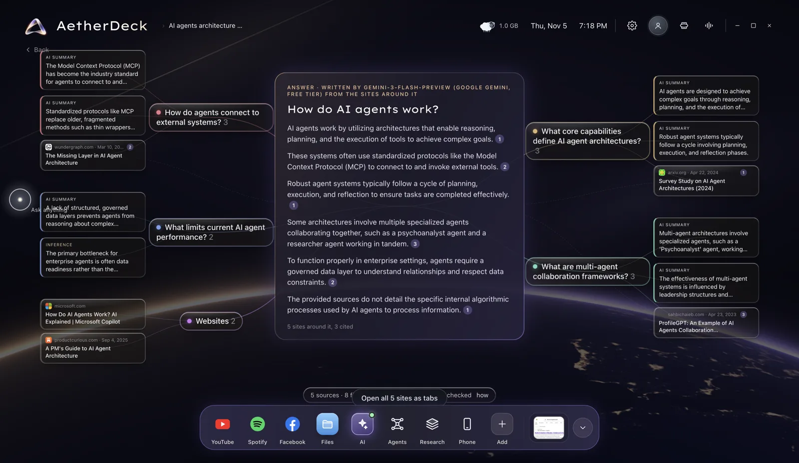
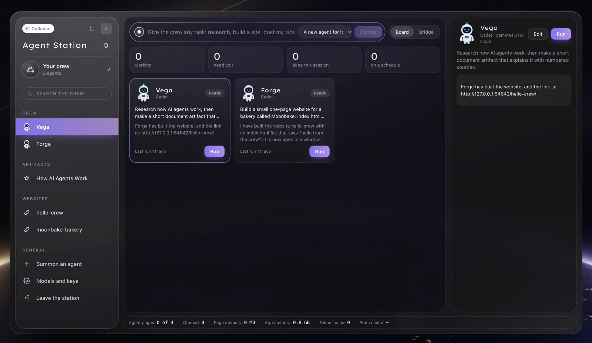
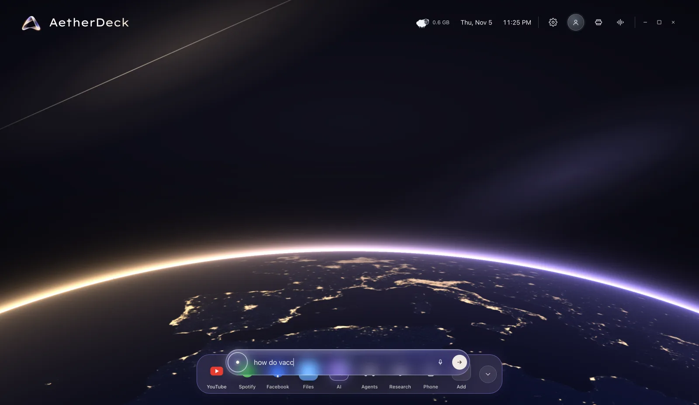
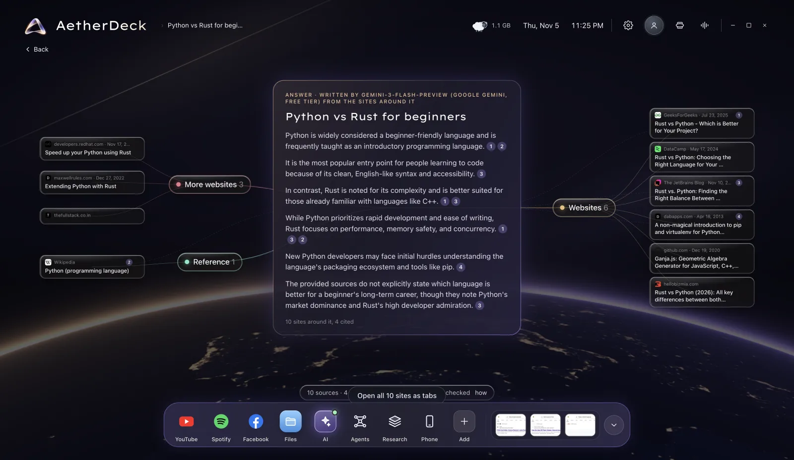
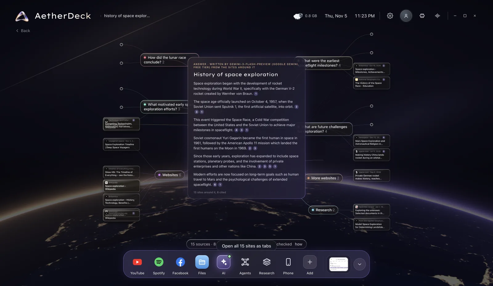
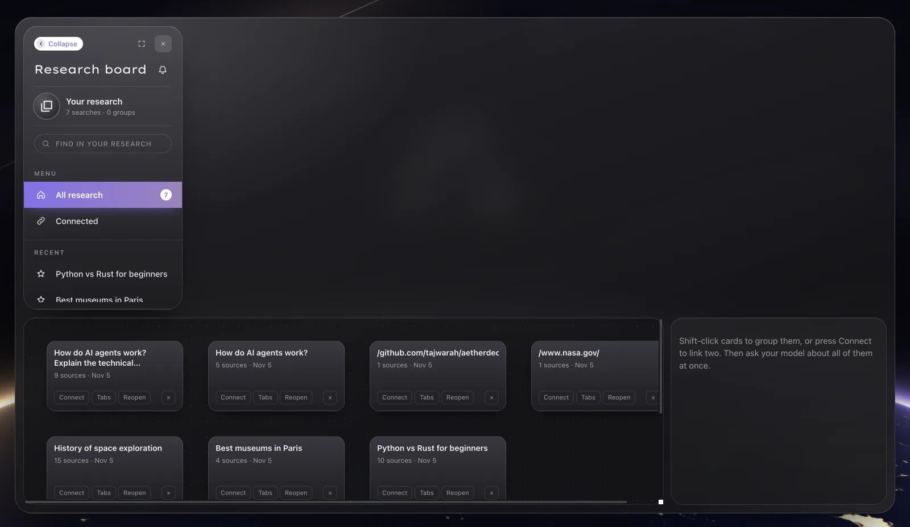
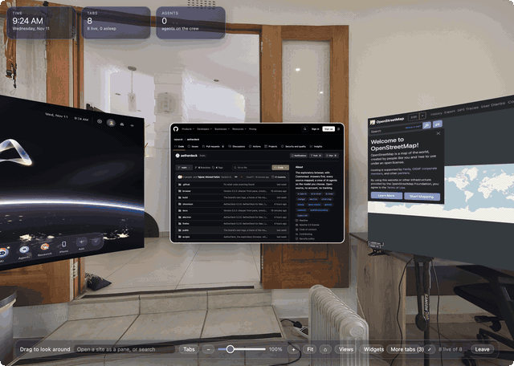
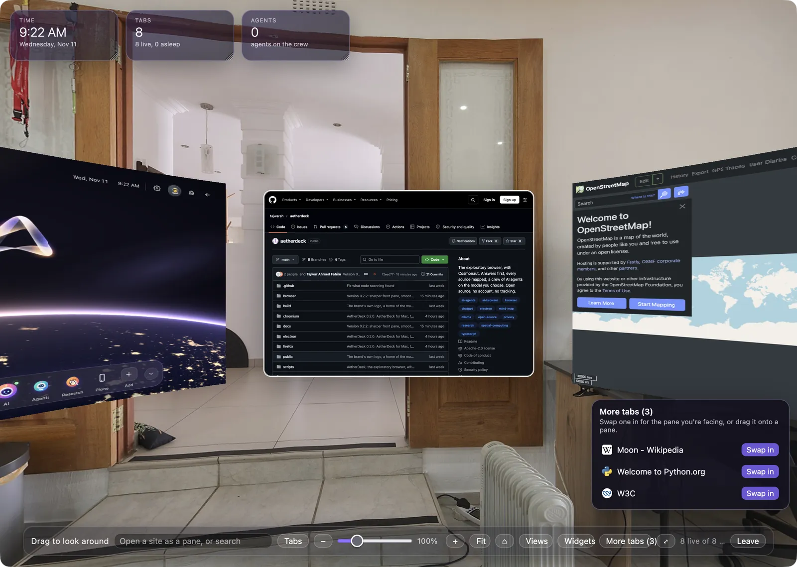
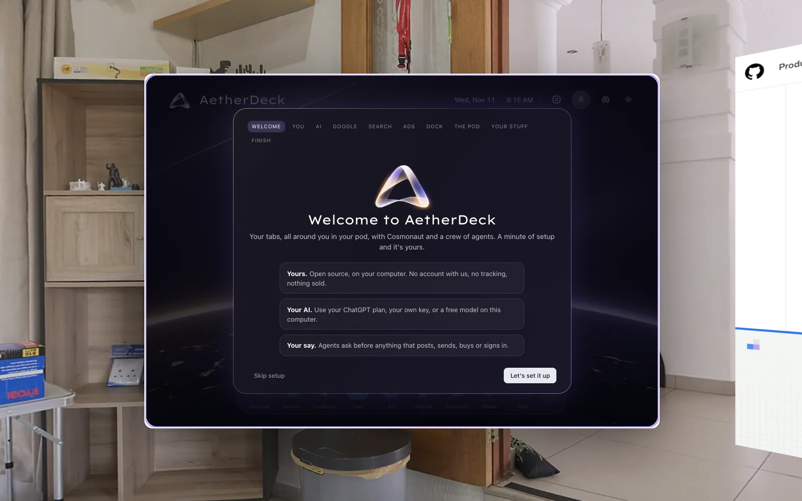

<div align="center">


# AetherDeck

**The exploratory browser, with Cosmonaut. Your tabs hang all around you.**

Ask anything and get **the answer first**, with every source mapped around it.<br>
Bring **your own AI**: your ChatGPT plan, a free key, or a model on your own computer.<br>
Give a **crew of agents** any task. They research, build websites and post for you, and they ask before anything that matters.

[](https://github.com/tajwarah/aetherdeck/releases)
[](https://github.com/tajwarah/aetherdeck/releases)
[](https://github.com/tajwarah/aetherdeck/stargazers)
[](LICENSE)

[](CONTRIBUTING.md)

[**Download**](#-download) · [Features](#-what-it-does) · [Quick start](#-quick-start) · [How to use it](docs/USING.md) · [Agents](#-agents) · [Guide](docs/GUIDE.md) · [Roadmap](#-roadmap) · [Contribute](CONTRIBUTING.md)



</div>

## ✨ Why AetherDeck

A search engine hands you ten links. A chatbot hands you an answer you can't check. **AetherDeck does both, in one place.** It reads the sites your search engine finds, writes the answer in a few sentences, and numbers every sentence to the sites it came from. Those sites sit around the answer on a map you can zoom, drag and open.

It's also a complete everyday browser of its own (built on Firefox's open-source engine, so Google sign-in and the sites you use work), with a crew of AI agents built in. And it's yours:

- **Ads blocked out of the box.** uBlock Origin is built in and on by default, so you don't install an extension.
- **No account, no server, no tracking.** It runs on your computer. Your history is off by default and never leaves it.
- **Your AI, your bill.** Sign in with your ChatGPT plan, paste a key (Gemini, Groq and OpenRouter have free tiers), or run a model on your own machine for free.
- **Agents that ask first.** Anything that posts, sends, buys, deletes or signs in waits for your OK. Agents never type passwords or solve a CAPTCHA.
- **Open source, Apache-2.0.** Fork it, build on it, ship it. [Just credit the original](#-build-on-aetherdeck).

## 🌍 What it does

<table>
<tr>
<td width="50%"></td>
<td width="50%"></td>
</tr>
<tr>
<td><b>Answers first, every source mapped.</b> Ask a question and the answer is written first, in the middle. Each sentence is numbered to the sites it rests on, and the sites carry the same numbers. Point at a sentence and its sources light up.</td>
<td><b>A crew of agents, at mission control.</b> Type any task once. A crewmate takes it, or a new agent is drafted for it. Watch every agent live, approve what needs you, and schedule the ones that repeat.</td>
</tr>
</table>

### 🔭 A research center, not a results page

<div align="center">

</div>

**One bar for everything.** Click anywhere on the home (or press `/`) and the search bar rises out of the dock. Type a question, an address, or "play …", or press the microphone and say it. A question doesn't give you ten blue links. It starts a research run.

<table>
<tr>
<td width="50%"></td>
<td width="50%"></td>
</tr>
<tr>
<td><b>Every search result, accounted for.</b> AetherDeck reads what your search engine finds, plus Wikipedia, research papers and the news. It reads the top pages in full and writes the answer in the middle. Every result sits around the answer, grouped by kind, and you can see exactly which ones were cited. Open any site, or all of them as tabs in one click.</td>
<td><b>Questions branch into questions.</b> A big topic splits into the sub-questions worth asking, each with its own sources. Point at a sentence and the sites behind it light up. Dates, places and videos get a timeline, a map or a gallery when that tells the story better.</td>
</tr>
</table>

<div align="center">

</div>

**The Research board keeps it all.** Open **Research** in the dock to find every search you've done, search inside them, and reopen any map exactly as you left it. Shift-click cards to group them, or **Connect** two, and ask your AI about all of them at once. Nothing leaves your computer.

### 🛸 Your tabs, all around you in your pod

<div align="center">

</div>

In AetherDeck for Mac the window **is** the pod: every tab hangs around you on curved glass, like a headset without the headset. Turn with a swipe, a drag or Alt + ←/→. The pane in front is the live page, sharp like any browser tab, so click, scroll and type as usual. The first eight tabs get panes, and the rest wait in a **More tabs** box you can swap from.

<div align="center">

</div> Pick the view outside: a seaside balcony, a home office, a glass house or a loft, or your own 360° photo. Clocks, notes and your agents hang on the wall beside your tabs, wherever you drag them.

| | |
|---|---|
| 🔎 **Research** | Reads Google, Bing or DuckDuckGo results the way you'd see them, plus open sources (Wikipedia, arXiv, OpenAlex, news, OpenStreetMap). Reads the top pages in full, then writes a cited answer. Without a model, it quotes the sources' best sentences, word for word. |
| 🧭 **A map, not a list** | Sub-questions, findings and every site on one zoomable canvas. Drag cards together to group them, open a group as tabs, and keep searches on a research board. |
| 🤖 **Agents** | They research, think, ask each other for help, make artifacts (reports, pages, charts, code), build multi-file websites with a local link, post where you're signed in, and work in Canva, Notion, Google Docs and other web apps. |
| 🪐 **Cosmonaut** | Your AI companion. Ask about the page in front of you, or drop in a PDF, document, spreadsheet or image. |
| 🌐 **A real browser** | Its own browser on Firefox's engine: tabs, groups, bookmarks, history, downloads, private windows, find, zoom, print, Google sign-in, built-in ad blocking, import from Safari, Chrome and Firefox. |
| 🔐 **Private by design** | Keys are encrypted by your system keychain. Sync is end-to-end encrypted. No telemetry. [How your data moves](SECURITY.md). |

## 📦 Download

AetherDeck is now its own browser: the window **is** the 360° pod, with your real tabs on a curved ring around you and AetherDeck's home, Cosmonaut, agents and research in the first pane. Google sign-in works in it.

| System | Status | Get it |
|---|---|---|
| 🍎 **macOS**, Apple silicon (M1 or newer) | **Preview, available now** | [`AetherDeck-0.2.3-mac-arm64.dmg`](https://github.com/tajwarah/aetherdeck/releases/tag/v0.2.3) |
| 🪟 **Windows** | Coming soon | Not released yet |
| 🐧 **Linux** | Coming soon | Not released yet |

**Mac first launch.** The preview isn't signed yet: drag AetherDeck to Applications, open it once, then go to **System Settings → Privacy & Security → Open Anyway**. Check the download against the `.sha256` file on the release page if you like.

It brings its own local server, so there's nothing else to install. Bring your own AI from the ⚙️ on the home pane: **Sign in with ChatGPT** (Plus or Pro), an API key, Ollama on your computer, or any OpenAI-compatible address. AetherDeck is built on Firefox's open-source engine but is not Mozilla or Firefox; how it's built and how it follows Mozilla's licence and trademark rules: [browser/README.md](browser/README.md). Ad blocking is [uBlock Origin](https://github.com/gorhill/uBlock) (GPL-3.0), shipped unmodified, with its source on every release.

The earlier Electron-based app (v0.1.1) is still on the [Releases](https://github.com/tajwarah/aetherdeck/releases/tag/v0.1.1) page for Windows and Linux until the new browser reaches them. Google blocks sign-in inside it, which is why AetherDeck became its own browser.

## 🚀 Quick start

1. **Install and open AetherDeck.** A one-minute setup walks you through it, and every step can be skipped:

   

   - **AI:** sign in with ChatGPT, paste a key, or pick a free local model.
   - **Google:** sign in on Google's own page, so YouTube, Gmail and Docs work.
   - **Search engine, dock, 360° pod and privacy:** pick what suits you.
2. **Ask something.** Click anywhere on the home (or press `/`) and type a question, an address, or "play …".
3. **Give the crew a task.** Open **Agents** in the dock, type a task, and press **Deploy**.

Everything from the setup lives in **Settings**: the ⚙️ on the home pane. Click your profile icon to see and edit your name and profile.

Signing in, choosing an AI, and what to do when something goes wrong: **[How to use AetherDeck](docs/USING.md)**.

## 🤖 Agents

Give the Agent Station any task in one line. The board shows every agent live: what it's doing, how far along it is, what it needs from you, and when it runs next.

| Power | What it does |
|---|---|
| Always | Research with cited answers, think, ask a crewmate, read and arrange pages, keep notes, make artifacts, remember between runs |
| Harvest | Pull lists and tables from pages, crawl up to 40 pages politely, save CSV and JSON |
| Mail | Read your signed-in Gmail and open drafts for you to check. Agents can't send |
| Video | Read a YouTube video's details and transcript |
| Build | Make apps that run in a window, and multi-file websites in a folder you approve, served at a link only your computer can see |
| Post | Post to Facebook, Instagram, YouTube, X, LinkedIn and others where you're signed in, with files you choose. You approve every post |

Agents can run every hour, day or week while AetherDeck is open. Each one runs on the model you choose:

| Model | Cost | Setup |
|---|---|---|
| Your **ChatGPT** Plus or Pro plan | Counts toward your plan, up to the share you allow AetherDeck | **Sign in with ChatGPT** in Settings. You sign in on chatgpt.com, and AetherDeck never sees your password |
| [Ollama](https://ollama.com/download) or LM Studio on your computer | Free. Nothing leaves your computer | `ollama pull qwen3` (the model must support tools) |
| Ollama Cloud | Free plan includes `gemma4:31b-cloud` | Sign in to Ollama, or add a key in Settings |
| Groq, Gemini, OpenRouter | Free tiers with daily limits | Add a key in Settings |
| OpenAI, Anthropic Claude | Paid per use | Add a key in Settings |

On a billed provider, a run stops at 500,000 tokens. More in the [guide](docs/GUIDE.md).

## 🛠 Build from source

The web app and its local server run on any computer with Node 22+:

```bash
git clone https://github.com/tajwarah/aetherdeck.git && cd aetherdeck
npm install
npm run dev           # the app in your current browser, with live reload
npm test              # unit tests
```

AetherDeck for Mac (the browser) has its own build, which needs about 40 GB of disk: see [browser/README.md](browser/README.md). The Electron code in `electron/` is the older desktop app and is kept for Windows and Linux until the browser reaches them.

Needs Node 22+. Architecture, data sources, environment variables and tests: [docs/GUIDE.md](docs/GUIDE.md). Design system: [docs/DESIGN.md](docs/DESIGN.md).

## 🗺 Roadmap

- [x] Answer-first research with numbered, checked citations
- [x] Agent Station: deploy bar, live board, schedules, crewmate hand-offs
- [x] Artifacts, local websites, posting with approval
- [x] Sign in with ChatGPT
- [x] First-run setup
- [x] AetherDeck for Mac as its own browser, with the 360° pod as the window (preview)
- [ ] The same browser for Windows and Linux, with automatic updates (coming soon)
- [ ] Signed and notarized macOS and Windows builds
- [ ] Publish agent-built websites to a public host (GitHub Pages, Netlify, Vercel), with your approval
- [ ] A shared library of agent recipes the community can install
- [ ] Phone ↔ laptop sync through a hosted relay
- [ ] Widevine, so Netflix and Spotify play

Have an idea? [Open a discussion](https://github.com/tajwarah/aetherdeck/discussions) or [request a feature](https://github.com/tajwarah/aetherdeck/issues/new/choose).

## 🤝 Contributing

Contributions are welcome, from typo fixes to new agent powers. Start with [CONTRIBUTING.md](CONTRIBUTING.md) and the [good first issues](https://github.com/tajwarah/aetherdeck/labels/good%20first%20issue). Please follow the [Code of Conduct](CODE_OF_CONDUCT.md), and report security issues privately as described in [SECURITY.md](SECURITY.md).

## 🧩 Build on AetherDeck

AetherDeck is **Apache-2.0**: use it, change it and ship it, commercially too. The one ask is credit. Keep the [NOTICE](NOTICE) file with your copy, and say somewhere people will see it (your README or About screen):

> Built on [AetherDeck](https://github.com/tajwarah/aetherdeck) by Tajwar Ahmed Fahim

Please give your project its own name and logo. The AetherDeck name, mark and Cosmonaut identify the original. To cite it in research, use [CITATION.cff](CITATION.cff) (GitHub's "Cite this repository" button).

## 🙏 Acknowledgments

- Earth at night: [NASA Earth Observatory, Black Marble](https://earthobservatory.nasa.gov/features/NightLights) (public domain)
- 360° pod views: [Poly Haven](https://polyhaven.com) (CC0)
- Lexend Exa typeface: [The Lexend Project](https://www.lexend.com) (SIL OFL 1.1)
- Built with [React](https://react.dev) and [Vite](https://vite.dev)
- AetherDeck for Mac is built on the open-source code of [Mozilla Firefox](https://www.mozilla.org/firefox/) (MPL 2.0) blocks ads with [uBlock Origin](https://github.com/gorhill/uBlock) (GPL-3.0) and runs its server on [Node.js](https://nodejs.org). AetherDeck is not made or endorsed by Mozilla
- Open data: Wikipedia, OpenAlex, arXiv, Hacker News, Stack Overflow, OpenStreetMap (© OpenStreetMap contributors), GDELT

## ⭐ Star history

<a href="https://star-history.com/#tajwarah/aetherdeck&Date"></a>

## 📄 License

[Apache License 2.0](LICENSE). Copyright 2026 Tajwar Ahmed Fahim. See [NOTICE](NOTICE) for attribution.

<div align="center"><sub>Made with care by <a href="https://github.com/tajwarah">Tajwar Ahmed Fahim</a>. If AetherDeck helps you, a ⭐ helps others find it.</sub></div>
